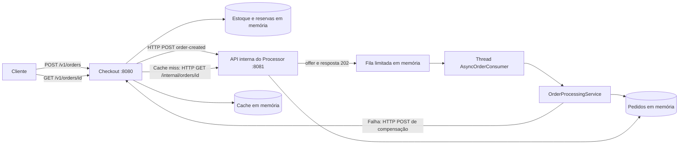

# Flash Sale — Implementação MOCK

## 1. Introdução e finalidade

A abordagem MOCK permite estudar o processamento assíncrono de pedidos e a compensação de estoque usando duas aplicações Java independentes, sem instalar Redis, RabbitMQ ou PostgreSQL. Ela preserva regras de negócio e contratos HTTP, substituindo os mecanismos externos de armazenamento e mensageria por componentes locais.

A apresentação acadêmica, os requisitos e a arquitetura com infraestrutura real estão no [README principal](README.md). Este documento contém somente a execução e os detalhes da simulação.

## 2. Motivação para componentes simulados

A simulação reduz o número de dependências necessárias para observar validação, reserva, processamento posterior e devolução de estoque. Também facilita reproduzir falhas e testar concorrência ou expiração de cache de maneira controlada.

É importante distinguir a simulação da infraestrutura do comportamento executado: as duas JVMs, as requisições HTTP, a serialização JSON e a thread consumidora são reais. A durabilidade e as garantias de entrega de um broker não são reproduzidas pela fila em memória.

## 3. Componentes simulados e responsabilidades

| Componente | Responsabilidade e mecanismo |
|---|---|
| [InMemoryStockRepository][stock] | Mantém saldo em `ConcurrentHashMap`; `computeIfPresent` verifica e decrementa atomicamente por produto dentro da JVM |
| [ReservationService][reservations] | Registra produto/quantidade por UUID, publicação e devolução; sincroniza a restauração para evitar estoque duplicado |
| [HttpMockOrderEventPublisher][publisher] | Envia `order-created` por HTTP ao Processor e exige HTTP 202 |
| [OrderMessageResource][messages] | Valida o evento recebido e o coloca na fila; devolve 503 se a fila estiver cheia |
| [InMemoryOrderEventQueue][queue] | Usa `ArrayBlockingQueue`, com capacidade padrão de 1.000 eventos |
| [AsyncOrderConsumer][consumer] | Retira eventos da fila em uma thread dedicada e chama o processamento |
| [OrderProcessingService][processing] | Persiste em memória, aplica a política de sucesso/falha e tenta publicar a compensação |
| [InMemoryOrderRepository][repository] | Mantém pedidos por UUID e ignora inserções duplicadas com `putIfAbsent` |
| [HttpMockOrderCompensationPublisher][compensation] | Envia a compensação ao Checkout por HTTP e exige resposta 204 |
| [InMemoryOrderCache][cache] | Cache separado do repositório de pedidos, com TTL de cinco minutos |

O saldo inicial é `PROD-001=10` e `PROD-002=0`. Produto desconhecido é tratado como sem saldo. Não existe banco persistente nem outbox durável nesse modo; o registro de publicação fica no serviço de reservas em memória.

## 4. Arquitetura e fluxo de comunicação MOCK



### 4.1. Sucesso

1. [CheckoutService][checkout] valida produto, quantidade positiva e CPF não vazio, e reserva o saldo local. Não valida dígitos verificadores do CPF nem exige nome.
2. Gera UUID v4, registra a reserva e publica por HTTP em `POST /internal/mock/messages/order-created` no Processor.
3. O Processor enfileira e retorna 202. O Checkout então responde ao cliente com 202 e `PROCESSING`. Portanto, a criação aguarda a aceitação HTTP do evento, mas não o processamento final.
4. A thread consumidora aplica [ProcessingPolicy][policy], grava `CONFIRMED` e mantém o histórico `PROCESSING → CONFIRMED`.
5. A consulta pública usa [OrderQueryResource][query] para ler primeiro o cache e, em caso de ausência, consultar o Processor por HTTP. Somente pedidos confirmados são cacheados, com cabeçalhos `X-Cache: MISS` e `HIT` para observação.

A consulta de um pedido ainda ausente no Processor faz três tentativas, separadas por 100 ms, antes de retornar 404. Indisponibilidade da dependência resulta em 503. O cache expira após 300 segundos; entradas vencidas são removidas durante leituras e novas gravações.

### 4.2. Falha e compensação

Quando a política determina falha, o pedido passa para `CANCELLED` com `compensacao=PENDING`. O worker envia `POST /internal/mock/messages/order-compensation` ao Checkout. [CompensationResource][comp-resource] aplica a devolução e responde 204; só então o Processor grava `compensacao=COMPLETED`.

Essa compensação é assíncrona em relação à compra original, mas o envio feito pelo worker é uma chamada HTTP síncrona. Não existe fila separada para compensações. Se o envio falhar, a pendência permanece e pode ser retentada manualmente.

A **idempotência** evita repetir o efeito da mesma mensagem: inserções de pedidos usam o UUID como chave, e a reserva só pode ser restaurada uma vez, com produto e quantidade iguais aos originais. Isso não torna o POST de compra idempotente: cada nova requisição gera outro UUID.

## 5. Diferenças entre MOCK e REAL

| Aspecto | MOCK | REAL |
|---|---|---|
| Estoque e reservas | Estruturas locais; atomicidade na JVM | Redis e scripts Lua |
| Transporte de pedidos | HTTP e fila em memória | RabbitMQ |
| Compensação | HTTP no worker, retry manual | Evento via outbox e RabbitMQ |
| Pedidos | Mapa em memória no Processor | PostgreSQL do Processor |
| Intenção de publicação | Registro volátil | PostgreSQL do Checkout |
| Cache | Mapa local com TTL | Redis com TTL |
| Confirmação de transporte | Resposta HTTP do destino | Publisher confirms e ack de entrega |
| Retentativas de mensagens | Sem retry geral ou DLQ | Filas de retry e DLQ |
| Reinício | Perde dados locais | Dados em volumes persistentes |
| Dependências externas para execução | Nenhuma | Redis, RabbitMQ e dois PostgreSQL |

A configuração e a execução REAL permanecem no [README principal](README.md#7-preparação-e-execução-real). O MOCK não fornece evidência de persistência em disco, recuperação do broker ou transações entre banco e outbox.

## 6. Estratégias de simulação e configuração

As configurações de [Checkout][co-config] e [Processor][op-config] selecionam o modo com `quarkus.profile=mock`, mantendo `flashsale.real=false`. Datasources e Dev Services ficam desativados; não há inicialização automática de containers.

| Propriedade | Valor padrão relevante | Aplicação |
|---|---|---|
| `quarkus.http.port` | 8080 / 8081 | Porta do Checkout / Processor |
| `quarkus.rest-client.processor.url` | `http://localhost:8081` | Destino do Checkout para envio e consulta |
| `quarkus.rest-client.checkout.url` | `http://localhost:8080` | Destino da compensação no Processor |
| `checkout.events.transport` | `http` | Transporte para integrar as duas aplicações |
| `processor.mock.queue-capacity` | `1000` | Limite da fila de pedidos |
| `processor.mock.failure-mode` | `never` | Aceita `never` ou `always`; este último cancela todos os pedidos |
| `flashsale.demo.enabled` | `false` | Habilita explicitamente preparação e falha por marcador |

O perfil `test` seleciona `checkout.events.transport=memory`: [InMemoryOrderEventPublisher](checkout-service/src/main/java/br/com/estudo/flashsale/infrastructure/InMemoryOrderEventPublisher.java) apenas registra eventos para os testes isolados. Ele não envia pedidos à outra JVM. Para demonstrar a integração, use o perfil `mock` com transporte HTTP.

Alguns recursos de inspeção usam `@IfBuildProfile` e só entram no build nos perfis `dev`, `test` ou `mock`. Recompile os artefatos ao mudar para esta abordagem. Os controles `/internal/demo/*` são habilitados por configuração de runtime e retornam 404 quando desativados.

## 7. Execução e exemplos práticos

### 7.1. Pré-requisitos e inicialização rápida

Instale JDK 21, Maven, Bash, curl e Python 3. Confira `java -version` e `mvn -version`: ambos devem apontar para Java 21. A primeira compilação requer rede para obter dependências Maven. Execute a partir da raiz do repositório, com as portas 8080 e 8081 livres:

```bash
bash scripts/run-mock.sh
```

O [launcher](scripts/run.sh) compila os módulos no perfil `mock`, inicia duas JVMs, habilita demonstração por padrão e aguarda `/health/ready`. Os logs ficam em [.run/checkout.log](.run/checkout.log) e [.run/processor.log](.run/processor.log). Ctrl+C encerra os processos iniciados pelo launcher; reiniciar ambas as JVMs recria o estado inicial.

Se já houver configuração local de ambiente, o launcher a carregará. `CHECKOUT_PORT` e `PROCESSOR_PORT` ajustam as portas e URLs entre os processos; mantenha `PROCESSOR_FAILURE_MODE=never` para o roteiro combinado. Remova configurações herdadas que forcem a infraestrutura real. Não execute os dois ambientes nas mesmas portas.

### 7.2. Inicialização independente

Para compilar e executar em modo de desenvolvimento, use dois terminais:

```bash
# Terminal 1
mvn -f order-processor-service/pom.xml quarkus:dev \
  -Dquarkus.profile=mock -Dflashsale.demo.enabled=true
```

```bash
# Terminal 2
mvn -f checkout-service/pom.xml quarkus:dev \
  -Dquarkus.profile=mock -Dflashsale.demo.enabled=true
```

Alternativamente, compile os artefatos JVM:

```bash
mvn -f checkout-service/pom.xml package -DskipTests -Dquarkus.profile=mock
mvn -f order-processor-service/pom.xml package -DskipTests -Dquarkus.profile=mock
```

Inicie cada comando em seu próprio terminal:

```bash
java -Dquarkus.profile=mock -Dflashsale.demo.enabled=true \
  -jar order-processor-service/target/quarkus-app/quarkus-run.jar
```

```bash
java -Dquarkus.profile=mock -Dflashsale.demo.enabled=true \
  -jar checkout-service/target/quarkus-app/quarkus-run.jar
```

Esses comandos usam os valores padrão; Maven/Java não carregam automaticamente o arquivo local de ambiente usado pelo launcher. Para alterar portas manualmente, ajuste também as URLs dos REST Clients com as propriedades da seção 6. Encerre com Ctrl+C em cada terminal.

### 7.3. Verificação e roteiro automatizado

```bash
curl -f http://localhost:8080/health/ready
curl -f http://localhost:8081/health/ready
bash scripts/demo-mock.sh
```

A prontidão retorna `{"status":"UP","mode":"mock"}`; não verifica dependências externas nem garante conectividade entre as duas aplicações. O [roteiro compartilhado](scripts/demo-flow.py), chamado no modo correto pelo script, testa comunicação, pedido confirmado, cache MISS/HIT e cancelamento com devolução. O saldo parte de 10 e termina em 8, pois somente a compra confirmada consome duas unidades.

O prazo padrão é 45 segundos, ajustável com `DEMO_TIMEOUT`. `CHECKOUT_URL` e `PROCESSOR_URL` permitem usar outros destinos. Falhas de validação retornam código não zero. Os endpoints de preparação repõem somente `PROD-001`, preservando os pedidos e reservas; retornam 409 quando há operações pendentes. Execute uma demonstração de cada vez, sem tráfego concorrente de outros usuários.

### 7.4. Compra, consulta e observação manual

```bash
curl -i -H 'Content-Type: application/json' \
  -d '{"produto_id":"PROD-001","quantidade":2,"cliente_cpf":"50329291076","cliente_nome":"Estudante"}' \
  http://localhost:8080/v1/orders
```

A resposta é HTTP 202 com `pedido_id`, `status=PROCESSING` e `data_hora_requisicao`. Guarde o UUID recebido:

```bash
ID=UUID_RECEBIDO
curl -s "http://localhost:8081/internal/orders/$ID"
# Aguarde CONFIRMED; as duas consultas públicas seguintes demonstram o cache:
curl -i "http://localhost:8080/v1/orders/$ID"
curl -i "http://localhost:8080/v1/orders/$ID"
curl -s http://localhost:8080/internal/mock/stock/PROD-001
tail -f .run/checkout.log .run/processor.log
```

A consulta do pedido inclui `historico=["PROCESSING","CONFIRMED"]` e `compensacao=NOT_REQUIRED`. Em uma execução nova, a reserva de duas unidades deixa saldo 8. Se já executou o roteiro automatizado, o saldo reflete as compras anteriores. Os logs acima existem quando se usa o launcher; no modo de desenvolvimento os logs aparecem nos próprios terminais.

### 7.5. Falha controlada e retry de compensação

O roteiro automatizado já exercita uma falha isolada por marcador, mantendo os demais pedidos no fluxo normal. Para estudar somente cancelamentos, encerre as JVMs anteriores e inicie:

```bash
bash scripts/run-mock-failure.sh
```

Esse launcher seleciona `always`. Reenvie a compra do exemplo anterior e consulte o novo UUID: espera-se `CANCELLED`, `compensacao=COMPLETED` e estoque restaurado após a entrega HTTP. Não execute o roteiro combinado nesse modo, pois ele também exige uma compra confirmada.

Se a compensação não chegar ao Checkout, o campo permanece `PENDING`. Após recuperar a comunicação, tente novamente sem reenviar a compra:

```bash
FAILED_ID=UUID_DO_PEDIDO_CANCELADO
curl -i -X POST "http://localhost:8081/internal/mock/orders/$FAILED_ID/retry-compensation"
curl -s "http://localhost:8080/internal/mock/reservations/$FAILED_ID"
```

O retry retorna 204 quando concluído, inclusive se já havia sido aplicado; retorna 503 se a entrega falha, 400 se o pedido não está cancelado e 404 se não existe. O resultado da reserva deve ser `{"status":"COMPLETED"}`. Reiniciar o Checkout perde as reservas, portanto não é uma maneira de recuperar uma compensação pendente.

## 8. Testes disponíveis

Os testes abaixo usam Java 21 e dependências isoladas. Não exigem Docker e não validam garantias dos serviços externos.

### 8.1. Testes unitários

```bash
mvn -f checkout-service/pom.xml test -Dtest=CheckoutServiceTest,ReservationServiceTest,InMemoryOrderCacheTest
mvn -f order-processor-service/pom.xml test -Dtest=OrderProcessingServiceTest,ProcessingPolicyTest
```

| Teste | Comportamentos verificados |
|---|---|
| [CheckoutServiceTest](checkout-service/src/test/java/br/com/estudo/flashsale/application/CheckoutServiceTest.java) | Contrato do evento, validação, estoque insuficiente e restauração após falha de publicação |
| [ReservationServiceTest](checkout-service/src/test/java/br/com/estudo/flashsale/application/ReservationServiceTest.java) | Compensações concorrentes, devolução única e tentativa após falha ao restaurar |
| [InMemoryOrderCacheTest](checkout-service/src/test/java/br/com/estudo/flashsale/infrastructure/InMemoryOrderCacheTest.java) | MISS, HIT e expiração com relógio controlado, sem esperar cinco minutos |
| [OrderProcessingServiceTest](order-processor-service/src/test/java/br/com/estudo/flashsale/application/OrderProcessingServiceTest.java) | Confirmação, cancelamento, entrega pendente, retry, duplicatas, transições e fila limitada |
| [ProcessingPolicyTest](order-processor-service/src/test/java/br/com/estudo/flashsale/application/ProcessingPolicyTest.java) | Marcador afeta somente o pedido selecionado e repete a decisão na mesma instância |

### 8.2. Integração de módulo

```bash
mvn -f checkout-service/pom.xml test
mvn -f order-processor-service/pom.xml test
```

Além dos unitários, essas suítes incluem:

- [CheckoutIntegrationTest](checkout-service/src/test/java/br/com/estudo/flashsale/infrastructure/CheckoutIntegrationTest.java): contratos HTTP 202/400/409/503, UUID, reserva e concorrência sem overselling.
- [CompensationIntegrationTest](checkout-service/src/test/java/br/com/estudo/flashsale/infrastructure/CompensationIntegrationTest.java): entrega duplicada, rejeição de compensação inválida e preservação de erros HTTP.
- [ProcessorIntegrationTest](order-processor-service/src/test/java/br/com/estudo/flashsale/api/ProcessorIntegrationTest.java): recepção e processamento assíncrono, mensagens inválidas e pedido ausente.
- [OrderMessageResourceTest](order-processor-service/src/test/java/br/com/estudo/flashsale/api/OrderMessageResourceTest.java): teste direto do recurso com fila limitada; apesar do pacote `api`, é um teste isolado, não ponta a ponta.
- [DemoDisabledTest do Checkout](checkout-service/src/test/java/br/com/estudo/flashsale/api/DemoDisabledTest.java) e [do Processor](order-processor-service/src/test/java/br/com/estudo/flashsale/api/DemoDisabledTest.java): controles de demonstração retornam 404 por padrão.

### 8.3. Ponta a ponta entre duas JVMs

Depois de compilar os artefatos no perfil `mock`, como na seção 7.2:

```bash
python3 scripts/test-local-flow.py
```

O [teste de fluxo](scripts/test-local-flow.py) inicia processos independentes em portas locais livres e encerra os processos que criou ao terminar. Verifica sucesso, mensagens duplicadas, Processor indisponível, reserva devolvida, compensação idempotente, falha de entrega com retry, preparação bloqueada por pendência e concorrência HTTP. Executa também duas vezes o roteiro de demonstração e confere logs correlacionados.

Não utilize `python3 -O`: o script possui verificações com `assert`. Os resultados precisam ser obtidos pela execução; esta revisão documental não reexecutou as suítes. A validação com infraestrutura real está descrita no [README principal](README.md#9-testes-e-validação).

## 9. Limitações da simulação

- **Dados voláteis:** encerrar uma JVM perde seus pedidos, reservas, fila ou cache. As estruturas não são compartilhadas entre réplicas.
- **Entrega sem durabilidade:** HTTP 202 significa que o evento entrou na fila local, não que sobreviverá a uma queda. Não há publisher confirms, acknowledgments AMQP, retry geral ou DLQ.
- **Falha ambígua de publicação:** o Checkout restaura a reserva quando o envio falha. Um timeout pode ocorrer depois de o Processor aceitar o evento, permitindo processamento de um pedido cuja reserva já foi devolvida.
- **Compensação manualmente recuperável:** não há outbox ou agendamento de retry. O endpoint de retry depende de pedido e reserva ainda existirem nas JVMs.
- **Falha inesperada no consumidor:** o evento já retirado da fila é registrado como erro e não é reenfileirado automaticamente.
- **Controles locais:** as rotas internas não têm autenticação. Os controles de demonstração devem ser usados em ambiente dedicado; inspeções MOCK não equivalem a uma interface administrativa protegida.
- **Escopo funcional:** não há pagamento real ou simulação de um provedor externo de pagamento; o cancelamento vem de uma política configurável. Não se pode inferir desempenho ou tolerância a falhas de produção a partir deste ambiente.

## 10. Possibilidades de evolução e substituição

O próprio repositório já possui a alternativa REAL para estudar a substituição de mapas por Redis/PostgreSQL e do transporte simulado por RabbitMQ. Essa substituição exige tratar confirmação, transações locais, duplicatas e recuperação de intenções; não basta trocar a fila em memória por uma chamada de publicação.

Como evolução didática, podem ser ampliados testes de falhas de rede, documentadas sequências de recuperação e reforçada a separação entre política de negócio e adaptadores. Qualquer nova garantia de entrega deverá ser implementada e validada antes de ser atribuída à simulação.

[stock]: checkout-service/src/main/java/br/com/estudo/flashsale/infrastructure/InMemoryStockRepository.java
[reservations]: checkout-service/src/main/java/br/com/estudo/flashsale/application/ReservationService.java
[publisher]: checkout-service/src/main/java/br/com/estudo/flashsale/infrastructure/HttpMockOrderEventPublisher.java
[messages]: order-processor-service/src/main/java/br/com/estudo/flashsale/api/OrderMessageResource.java
[queue]: order-processor-service/src/main/java/br/com/estudo/flashsale/infrastructure/InMemoryOrderEventQueue.java
[consumer]: order-processor-service/src/main/java/br/com/estudo/flashsale/infrastructure/AsyncOrderConsumer.java
[processing]: order-processor-service/src/main/java/br/com/estudo/flashsale/application/OrderProcessingService.java
[repository]: order-processor-service/src/main/java/br/com/estudo/flashsale/infrastructure/InMemoryOrderRepository.java
[compensation]: order-processor-service/src/main/java/br/com/estudo/flashsale/infrastructure/HttpMockOrderCompensationPublisher.java
[cache]: checkout-service/src/main/java/br/com/estudo/flashsale/infrastructure/InMemoryOrderCache.java
[checkout]: checkout-service/src/main/java/br/com/estudo/flashsale/application/CheckoutService.java
[policy]: order-processor-service/src/main/java/br/com/estudo/flashsale/application/ProcessingPolicy.java
[query]: checkout-service/src/main/java/br/com/estudo/flashsale/api/OrderQueryResource.java
[comp-resource]: checkout-service/src/main/java/br/com/estudo/flashsale/api/CompensationResource.java
[co-config]: checkout-service/src/main/resources/application.properties
[op-config]: order-processor-service/src/main/resources/application.properties
