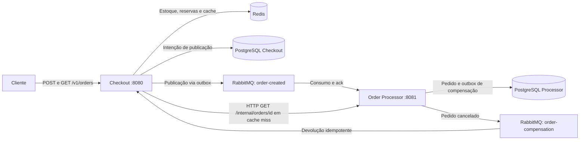
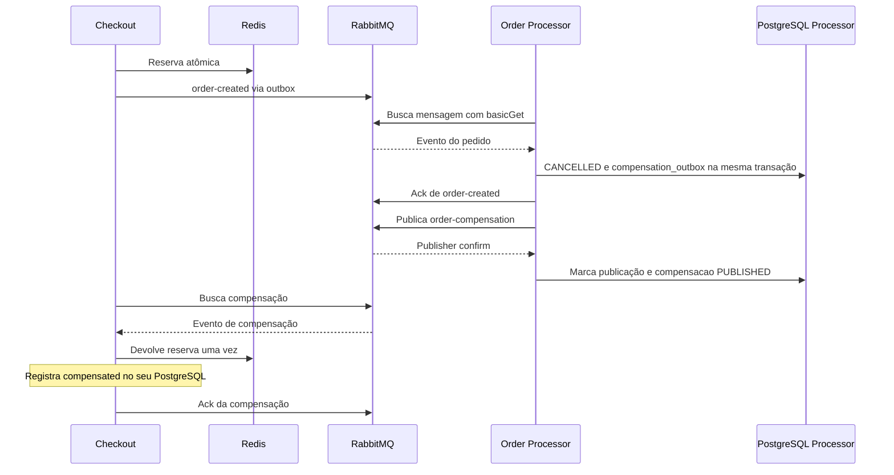

# Sistema de Checkout e Reserva de Estoque Relâmpago (Flash Sale)

| Identificação acadêmica | Informação |
|---|---|
| Título do trabalho | Sistema de Checkout e Reserva de Estoque Relâmpago com Microsserviços |
| Nome do aluno | [PREENCHER] |
| Turma | [PREENCHER] |
| Disciplina | [PREENCHER] |
| Professor | [PREENCHER] |
| Instituição | [PREENCHER] |
| Data | [PREENCHER] |

Este documento apresenta a **implementação REAL**: duas aplicações Java independentes, com Redis, RabbitMQ e PostgreSQL. A abordagem simulada possui documentação própria em [README-MOCK.md](README-MOCK.md).

## 1. Introdução e contextualização

Em uma promoção relâmpago, muitos clientes podem tentar comprar o mesmo produto simultaneamente. Consultar o saldo e depois decrementá-lo em operações independentes permite que duas compras utilizem a mesma unidade, provocando *overselling*. Além disso, esperar todo o processamento antes de responder aumenta o tempo da requisição e acopla a disponibilidade de todas as etapas.

O projeto divide essas responsabilidades entre Checkout e Order Processor. O Checkout valida a solicitação e reserva estoque; o Processor conclui o pedido posteriormente. O retorno HTTP `202 Accepted` significa que a solicitação foi aceita para processamento, não que a compra já foi confirmada.

Essa separação introduz desafios de sistemas distribuídos: uma mensagem pode ser reenviada, uma dependência pode ficar indisponível e o cancelamento pode aparecer antes da devolução do estoque. A implementação combina reserva atômica, registros duráveis de publicação, processamento idempotente e compensação. A consistência é eventual: serviços convergem para um resultado após processar os eventos, sem uma transação única envolvendo todas as tecnologias.

## 2. Objetivos e relação com os requisitos

O objetivo geral é implementar e demonstrar um fluxo de compra assíncrono que preserve o estoque e permita consultar o resultado do pedido.

A referência disponível é [especificacao-projeto-final.md](especificacao-projeto-final.md), correspondente ao enunciado do trabalho; não há arquivo denominado `Projeto_final.md` nesta revisão. Os objetivos específicos e suas evidências são:

| Objetivo específico | Requisito do enunciado | Evidência na implementação |
|---|---|---|
| Receber e validar compras sem esperar o processamento final | Seção 4.1 | [OrderResource][co-resource] e [RealCheckoutService][co-real]: UUID v4, reserva e HTTP 202 |
| Evitar estoque negativo sob concorrência | Seções 4.1 e 6 | [RedisStockRepository][co-stock]: verificação e decremento no mesmo script Lua |
| Desacoplar criação e processamento | Seções 3 e 4.4 | [RabbitBroker][co-broker] e [RealWorker do Processor][op-worker] |
| Manter dados sob responsabilidade de cada serviço | Seção 6 | [Schema Checkout][co-schema] e [schema Processor][op-schema] em bancos separados |
| Compensar reservas de pedidos cancelados | Seção 5 | [PostgresOrderRepository][op-repository] e [RealCheckoutService][co-real] |
| Consultar pedidos com Cache-Aside e tentativas limitadas | Seção 4.2 | [OrderQueryResource][co-query]: Redis, consulta HTTP ao Processor e três tentativas em caso de ausência |
| Demonstrar sucesso, falha e recuperação | Seções 6 e 9 | [Roteiro de demonstração][demo-flow] e [teste ponta a ponta REAL][test-real] |

A tabela relaciona requisitos a código existente; não representa uma certificação de atendimento integral. A consulta ao banco ocorre pela API do serviço proprietário. Falhas técnicas de persistência são retentadas, enquanto o cancelamento de negócio é determinado por uma política didática; essas distinções são detalhadas abaixo.

## 3. Tecnologias utilizadas

| Categoria | Tecnologia | Função efetiva |
|---|---|---|
| Aplicação | Java 21 | Linguagem, JVM, records, concorrência e APIs de data/UUID |
| Aplicação | Quarkus 3.40.1 | REST, injeção de dependências CDI, configuração e tarefas agendadas |
| Aplicação | Jackson e REST Client | JSON e consultas HTTP entre serviços |
| Build | Maven | Dependências, compilação, empacotamento e testes por módulo |
| Persistência | PostgreSQL 17 e JDBC/Agroal | Pedidos, outboxes e transações locais; acesso SQL direto, sem ORM |
| Estoque e cache | Redis 7.4 | Reserva/compensação atômica com Lua e cache com TTL de 300 segundos |
| Mensageria | RabbitMQ 4 e cliente Java AMQP 5.25.0 | Filas duráveis, confirmação de publicação, acknowledgments, retry e DLQ |
| Infraestrutura | Docker e Docker Compose | Serviços locais, rede, volumes, healthchecks e build das aplicações |
| Testes | JUnit, Quarkus Test, REST Assured e Mockito | Regras isoladas e integração HTTP dos módulos |
| Automação | Bash, curl e Python 3 | Inicialização, demonstração e testes entre processos; Python usa a biblioteca padrão |

As versões e dependências estão nos [POMs do Checkout](checkout-service/pom.xml) e [Processor](order-processor-service/pom.xml), e as imagens no [Compose](compose.yml). A mensageria utiliza diretamente o cliente AMQP, sem canais de Reactive Messaging.

## 4. Arquitetura da solução REAL

### 4.1. Serviços, comunicação e propriedade dos dados

- **Checkout, porta 8080:** recebe compras, controla estoque/reservas no Redis, mantém a intenção de publicação em seu PostgreSQL, consome compensações e oferece a consulta pública com cache.
- **Order Processor, porta 8081:** consome pedidos, aplica a decisão de processamento, persiste o resultado no seu PostgreSQL e publica compensações quando há cancelamento.

As requisições do cliente e as consultas Checkout → Processor são síncronas por HTTP. Criação de pedidos e compensação são assíncronas via RabbitMQ. Nenhum serviço consulta diretamente o banco do outro.



### 4.2. Organização das responsabilidades

Os dois serviços possuem pacotes `api`, `application`, `domain`, `ports` e `infrastructure`. Essa organização evidencia a separação de responsabilidades e os limites dos domínios propostos no enunciado:

- `api` converte requisições/respostas HTTP e seleciona o fluxo de execução.
- `domain` contém eventos, estados e transições do pedido.
- `application` reúne validação, política de processamento e orquestração.
- `ports` define contratos de acesso a recursos externos.
- `infrastructure` contém os adaptadores e os workers.

A separação não é completa: [RealCheckoutService][co-real] usa SQL e adaptadores concretos; [PostgresOrderRepository][op-repository] também coordena processamento e publicação. Portanto, o código demonstra princípios de separação de domínio e infraestrutura, mas não uma arquitetura hexagonal estrita. A validação em [CheckoutService][co-validation], a política em [ProcessingPolicy][op-policy] e as transições em [Order][op-order] são pontos de reutilização das regras.

### 4.3. RabbitMQ: roteamento, consumo e confirmação

O RabbitMQ atua como intermediário de mensagens (*broker*). Uma **exchange** recebe publicações e as encaminha para filas. Neste projeto, [RabbitBroker][co-broker] utiliza a exchange padrão, de nome vazio (`""`), com a chave de roteamento igual ao nome da fila. Não há exchange de negócio personalizada.

Uma **fila** retém mensagens até o consumo. Há duas filas principais, `order-created` e `order-compensation`, cada uma com as auxiliares `.retry` e `.dlq`. Todas são duráveis, e as mensagens são publicadas como persistentes (`deliveryMode=2`). O vhost `/flashsale` delimita o espaço lógico da aplicação no broker.

Um **consumidor** executa a ação associada ao evento. Aqui os [workers do Checkout][co-worker] e [Processor][op-worker] são agendados a cada segundo. O adaptador utiliza `basicGet` para buscar até 20 mensagens por chamada, com processamento serializado no canal. Não se trata de um consumidor registrado com `basicConsume`.

As duas confirmações têm significados diferentes:

| Mecanismo | O que confirma | Uso no código |
|---|---|---|
| Publisher confirm | O broker confirmou a publicação; não comprova processamento pelo destinatário | Publicação aguarda confirmação por até 3 segundos, com `mandatory` e verificação de mensagem sem rota |
| Acknowledgment (`ack`) | O consumidor terminou o tratamento daquela entrega | `basicAck` ocorre depois do handler ou depois de confirmar a cópia para retry/DLQ |

Quando o handler falha, o cabeçalho `x-attempt` é incrementado. As duas primeiras falhas enviam a mensagem para `.retry`, cujo TTL de 5 segundos a devolve à fila principal. A terceira a envia à **DLQ** (*Dead Letter Queue*), destinada à inspeção de mensagens que não puderam ser tratadas. Entregas sem ack retornam à fila quando a conexão é fechada. Não há reprocessamento automático da DLQ nem cancelamento automático do pedido por entrada nessa fila.

### 4.4. Persistência, Outbox Pattern e idempotência

PostgreSQL armazena dados duráveis e permite transações locais. O [schema do Checkout][co-schema] contém `checkout_outbox`; o [schema do Processor][op-schema] contém `orders` e `compensation_outbox`. Os payloads JSON são gravados em colunas `TEXT`, com conversões para `jsonb` em algumas consultas/atualizações. Cada aplicação inicializa suas tabelas com seu próprio script SQL; não há ferramenta de migrações versionadas configurada.

O **Outbox Pattern** registra a intenção de enviar um evento no banco, permitindo tentar novamente se o broker estiver indisponível:

1. [RealCheckoutService][co-real] grava a intenção como `PREPARED` antes de acessar o Redis.
2. A reserva atômica muda a intenção para `READY`, ou para `REJECTED` quando falta estoque.
3. O worker recupera intenções pendentes, publica `order-created` e marca `SENT` após a confirmação do broker.
4. No Processor, [PostgresOrderRepository][op-repository] grava o pedido cancelado e a intenção de compensação na **mesma transação PostgreSQL**. Outro passo do worker publica essa intenção.

Redis e PostgreSQL não participam de uma transação distribuída. A ordem das operações, os registros pendentes e a reconciliação do worker reduzem as lacunas entre sistemas, mas dependem da preservação dos dados de ambos.

**Idempotência** significa que repetir uma operação identificada produz o mesmo efeito de negócio. Ela é necessária porque uma publicação pode chegar ao broker e ser repetida antes de o banco registrar sua conclusão. Neste projeto:

- [RedisStockRepository][co-stock] associa produto, quantidade e estado ao UUID em `reservation:UUID`; scripts Lua impedem reservar ou devolver a mesma reserva duas vezes.
- [PostgresOrderRepository][op-repository] utiliza a chave primária do pedido e `ON CONFLICT DO NOTHING` para não persistir/processar novamente o mesmo UUID.
- A compensação valida produto e quantidade contra a reserva original e invalida `order:UUID` no cache.

Essas medidas tratam reentregas internas. O endpoint de criação gera um novo UUID a cada POST: **não existe chave de idempotência fornecida pelo cliente**. Repetir uma compra HTTP pode criar outro pedido.

### 4.5. Compensação e Cache-Aside

A **SAGA simplificada** encadeia operações locais e uma ação compensatória. Se o processamento decide cancelar, o Checkout devolve o estoque anteriormente reservado. Isso não desfaz uma transação global: a devolução é uma nova operação, com seu próprio prazo e possíveis falhas.

[ProcessingPolicy][op-policy] confirma normalmente ou cancela conforme uma falha configurada. Mesmo com infraestrutura REAL, a decisão de falha é didática; não há integração de pagamento. Erros técnicos no handler, como falha ao gravar no banco, provocam retry/DLQ e não equivalem automaticamente a `CANCELLED`.

**Cache-Aside** é o padrão de consultar o cache antes da fonte. Em [OrderQueryResource][co-query], a chave `order:UUID` é lida no Redis; em caso de ausência, o Checkout chama `GET /internal/orders/{id}` no Processor. Somente `CONFIRMED` é cacheado, por 300 segundos, em [RedisOrderCache][co-cache]. Estados transitórios e cancelados permanecem consultados na fonte.

Se o Processor retorna 404, são feitas três tentativas, com intervalos de 100 ms. Depois, o Checkout ainda procura a intenção no seu outbox, podendo responder `PROCESSING` ou `CANCELLED` para uma intenção rejeitada. Só retorna 404 se não encontrar nenhum registro. Falha no cache permite consulta à fonte; indisponibilidade da consulta ao Processor resulta em 503.

## 5. Fluxo funcional

### 5.1. Cenário de sucesso

1. O cliente envia produto, quantidade e CPF para `POST /v1/orders`. A validação exige produto e CPF não vazios e quantidade positiva; não valida dígitos verificadores do CPF nem exige nome.
2. O Checkout gera UUID v4, grava a intenção e reserva o estoque com Lua. Para saldo 10 e quantidade 2, o saldo passa a 8.
3. O cliente recebe HTTP 202 com `PROCESSING`. A publicação ocorre pelo worker, sem exigir que o pedido já esteja no Processor.
4. O Processor consome o evento, aplica [ProcessingPolicy][op-policy] e grava o pedido `CONFIRMED`. O histórico registra `PROCESSING → CONFIRMED`, embora esses estados não sejam gravados em transações separadas no fluxo REAL.
5. O ack permite remover a entrega da fila. A consulta pública retorna o resultado, com `X-Cache: MISS` na primeira leitura confirmada e `HIT` na seguinte.

### 5.2. Falha de negócio e compensação



O estado do pedido pode ser `CANCELLED` antes de a reserva ficar `COMPLETED`. No Processor, o campo `compensacao` passa de `PENDING` para `PUBLISHED` quando o broker confirma a publicação; ele **não confirma a devolução do estoque**. A conclusão deve ser observada na reserva do Checkout e no saldo do Redis. Não há evento de retorno que atualize esse campo do Processor para `COMPLETED` no fluxo REAL.

### 5.3. Falhas de infraestrutura e respostas HTTP

| Situação | Comportamento implementado |
|---|---|
| Dados obrigatórios inválidos | 400, antes da reserva |
| Estoque insuficiente ou produto sem saldo | 409; intenção fica `REJECTED` |
| Banco do Checkout indisponível ao registrar intenção | 503 |
| Reserva fica incerta após registrar intenção | 503 com `pedido_id`; o worker tenta reconciliar `PREPARED`. Consultar esse UUID antes de repetir a compra |
| RabbitMQ indisponível depois da reserva | A intenção permanece pendente de publicação; o pedido pode já ter recebido 202 |
| Erro técnico tratando mensagem | Retry limitado e possível DLQ; não há garantia de conclusão automática após esgotar as tentativas |
| Pedido inexistente | 404 após as buscas descritas na seção 4.5 |

## 6. Organização do projeto

```text
.
├── README.md
├── README-MOCK.md
├── especificacao-projeto-final.md
├── compose.yml
├── .env.example
├── checkout-service/
│   ├── pom.xml, Dockerfile, mvnw
│   └── src/
│       ├── main/java/br/com/estudo/flashsale/
│       │   ├── api/             # Recursos HTTP e contratos
│       │   ├── application/     # Validação e orquestração do Checkout
│       │   ├── domain/          # Eventos e exceções
│       │   ├── ports/           # Contratos de infraestrutura
│       │   └── infrastructure/  # Redis, RabbitMQ, JDBC e worker
│       ├── main/resources/     # application.properties e db/schema.sql
│       └── test/java/           # Testes do módulo
├── order-processor-service/
│   ├── pom.xml, Dockerfile
│   └── src/                    # Mesma divisão de pacotes; domínio do pedido
└── scripts/                    # Inicialização, demonstração e testes de fluxo
```

A árvore destaca os arquivos do Flash Sale. Não há POM agregador na raiz: os comandos Maven apontam para o POM de cada serviço. As configurações estão em [application.properties do Checkout][co-config] e [application.properties do Processor][op-config].

## 7. Preparação e execução REAL

### 7.1. Pré-requisitos

Utilize Linux ou ambiente Bash compatível com os scripts fornecidos, Docker Engine disponível e Docker Compose com suporte a `--wait`. Para aplicações locais, instale **JDK 21 e Maven**; ambos os comandos abaixo devem indicar Java 21. Para os roteiros auxiliares, instale curl e Python 3. A primeira execução requer acesso aos repositórios Maven e às imagens Docker.

```bash
java -version
mvn -version
docker compose version
```

Se o Maven usar outro JDK, configure `JAVA_HOME` para a instalação do JDK 21 e coloque seu diretório `bin` no `PATH`. O Checkout também possui [Maven Wrapper](checkout-service/mvnw), mas os launchers invocam `mvn`.

Execute os comandos na raiz do repositório. Escolha **uma** das formas de inicialização abaixo para evitar conflitos de portas.

### 7.2. Configuração do ambiente

Os valores padrão permitem executar localmente sem alterações. Para personalizá-los, copie o exemplo apenas se ainda não houver configuração local:

```bash
cp -n .env.example .env
```

O [arquivo de exemplo](.env.example) define portas, credenciais locais e `PROCESSOR_FAILURE_MODE`. Os scripts carregam essa configuração; Maven e IDE não a carregam automaticamente. Nos exemplos seguintes, mantenha as portas padrão:

| Recurso | Endereço local | Endereço na rede Compose |
|---|---|---|
| Checkout | `localhost:8080` | `checkout-service:8080` |
| Processor | `localhost:8081` | `order-processor-service:8081` |
| Redis | `localhost:6379` | `redis:6379` |
| RabbitMQ AMQP | `localhost:5672` | `rabbitmq:5672` |
| RabbitMQ Management | `http://localhost:15672` | `rabbitmq:15672` |
| PostgreSQL Checkout | `localhost:5433/checkout` | `checkout-db:5432/checkout` |
| PostgreSQL Processor | `localhost:5434/processor` | `processor-db:5432/processor` |

Credenciais locais padrão: RabbitMQ `flashsale/flashsale`, vhost `/flashsale`; PostgreSQL Checkout `checkout/checkout`; PostgreSQL Processor `processor/processor`. As portas publicadas pelo Compose ficam vinculadas a `127.0.0.1`.

Para JVMs executadas manualmente, as propriedades aceitam variáveis como `QUARKUS_DATASOURCE_JDBC_URL`, `QUARKUS_DATASOURCE_PASSWORD`, `QUARKUS_REDIS_HOSTS`, `RABBITMQ_HOST`, `RABBITMQ_PORT`, `RABBITMQ_USERNAME`, `RABBITMQ_PASSWORD` e `QUARKUS_REST_CLIENT_PROCESSOR_URL`. A URL JDBC e a senha devem corresponder ao banco de cada processo. Dentro dos containers, o Compose já fornece os nomes de serviço adequados.

Os controles `/internal/demo/*` retornam 404 por padrão. Os exemplos de demonstração exigem `FLASHSALE_DEMO_ENABLED=true` ou `-Dflashsale.demo.enabled=true` nos dois serviços. Esses controles não têm autenticação e destinam-se a um ambiente local dedicado.

### 7.3. Infraestrutura em containers e aplicações locais

A opção automatizada é:

```bash
bash scripts/run-real-local.sh
```

O [launcher](scripts/run.sh) inicia Redis, RabbitMQ e os dois PostgreSQL, prepara o estoque inicial, compila os dois módulos e inicia JVMs com perfil `real`. Habilita demonstração por padrão, salvo configuração explícita contrária, aguarda prontidão e grava logs no diretório [.run](.run/). Deixe o terminal aberto.

Para executar as etapas separadamente, use os valores padrão de configuração:

```bash
# Primeiro: infraestrutura e carga inicial de estoque
bash scripts/run-infrastructure.sh
```

```bash
# Terminal 1: compila e inicia o Processor em modo de desenvolvimento
mvn -f order-processor-service/pom.xml quarkus:dev \
  -Dquarkus.profile=real -Dflashsale.demo.enabled=true
```

```bash
# Terminal 2: compila e inicia o Checkout em modo de desenvolvimento
mvn -f checkout-service/pom.xml quarkus:dev \
  -Dquarkus.profile=real -Dflashsale.demo.enabled=true
```

O seed usa `SET NX`: cria `PROD-001=10` e `PROD-002=0` apenas quando as chaves ainda não existem. Reiniciar a infraestrutura não repõe o saldo consumido. As aplicações criam as tabelas ao inicializar sua infraestrutura de persistência.

### 7.4. Alternativa: tudo em containers

Esta opção dispensa JDK e Maven locais, pois os [Dockerfiles do Checkout](checkout-service/Dockerfile) e [Processor](order-processor-service/Dockerfile) compilam as aplicações em uma etapa de build:

```bash
FLASHSALE_DEMO_ENABLED=true bash scripts/run-docker.sh
```

O script aguarda os healthchecks. O build utiliza `-DskipTests`; subir os containers não significa executar os testes. O launcher de execução normal seleciona processamento sem falha global, permitindo o marcador específico da demonstração.

### 7.5. Verificação e encerramento

```bash
curl -f http://localhost:8080/health/ready
curl -f http://localhost:8081/health/ready
docker compose ps
docker compose exec -T redis redis-cli PING
```

Espera-se HTTP 200 com `{"status":"UP","mode":"real"}` e `PONG` no Redis. A ordem dos campos JSON pode variar. O Checkout verifica seu banco, broker e Redis; o Processor verifica seu banco e broker. Prontidão não comprova que todos os pedidos foram concluídos.

Para encerrar, use Ctrl+C nos terminais das aplicações locais. O launcher encerra somente as JVMs que iniciou; os containers continuam até o comando abaixo:

```bash
bash scripts/stop-docker.sh
```

Esse comando encerra o Compose preservando os volumes, inclusive estoque, pedidos, reservas e outboxes.

## 8. Demonstração prática REAL

### 8.1. Roteiro automatizado

Com os dois serviços prontos e os controles habilitados:

```bash
bash scripts/demo-real.sh
```

O [roteiro][demo-flow] verifica os 12 passos da seção 9 do enunciado: estoque 10, criação/202/UUID, publicação, consumo e confirmação, cache MISS/HIT, falha controlada, compensação e estoque final 8. Ele usa polling e retorna código diferente de zero em caso de falha. `DEMO_TIMEOUT` permite alterar o prazo padrão de **45 segundos**; `CHECKOUT_URL` e `PROCESSOR_URL` permitem alterar os destinos.

A preparação redefine apenas `PROD-001` para 10 e preserva registros anteriores. Retorna 409 se houver reservas em trânsito ou compensação pendente. Use uma instância de cada serviço e não execute demonstrações simultâneas; a trava de preparação é local à JVM.

### 8.2. Criação e consulta manual

Em ambiente dedicado, prepare o saldo e envie uma compra:

```bash
curl -i -X POST http://localhost:8080/internal/demo/stock
curl -s http://localhost:8080/internal/demo/stock
# Esperado: {"disponivel":10}

curl -i -H 'Content-Type: application/json' \
  -d '{"produto_id":"PROD-001","quantidade":2,"cliente_cpf":"50329291076","cliente_nome":"Fernando Augusto"}' \
  http://localhost:8080/v1/orders
```

Resposta ilustrativa, HTTP 202; UUID e horário são gerados durante a execução:

```json
{
  "pedido_id": "b819cc65-f6f0-478c-8bb7-69ee1c4f6402",
  "status": "PROCESSING",
  "data_hora_requisicao": "2026-10-13T10:00:00"
}
```

Copie o UUID recebido para a variável abaixo:

```bash
ID=UUID_RECEBIDO
curl -s "http://localhost:8080/internal/demo/publications/$ID"
curl -s "http://localhost:8081/internal/orders/$ID"
# Aguarde o Processor responder CONFIRMED; então consulte o endpoint público:
curl -i "http://localhost:8080/v1/orders/$ID"
curl -i "http://localhost:8080/v1/orders/$ID"
```

A publicação passa a `{"published":true}` quando o outbox está `SENT`. A consulta final retorna HTTP 200, com uma representação como esta:

```json
{
  "pedido_id": "b819cc65-f6f0-478c-8bb7-69ee1c4f6402",
  "produto_id": "PROD-001",
  "quantidade": 2,
  "cliente_cpf": "50329291076",
  "cliente_nome": "Fernando Augusto",
  "status": "CONFIRMED",
  "data_hora_criacao": "2026-10-13T10:00:00",
  "data_hora_atualizacao": "2026-10-13T10:00:01",
  "historico": ["PROCESSING", "CONFIRMED"],
  "compensacao": "NOT_REQUIRED"
}
```

As duas consultas públicas demonstram `X-Cache: MISS` e depois `X-Cache: HIT`, desde que o pedido já esteja confirmado e o cache esteja disponível. Comprar `PROD-002`, que começa sem saldo, retorna HTTP 409 com `{"mensagem":"Estoque insuficiente para o produto PROD-002"}`. Quantidade zero retorna 400.

### 8.3. Cancelamento e devolução de estoque

O controle abaixo registra um marcador aceito por [DemoResource do Processor](order-processor-service/src/main/java/br/com/estudo/flashsale/api/DemoResource.java). Somente pedidos cujo nome corresponde a ele são cancelados. O exemplo de geração do UUID usa Linux:

```bash
MARKER="demo-failure-$(cat /proc/sys/kernel/random/uuid)"
curl -i -X POST "http://localhost:8081/internal/demo/failures/$MARKER"
curl -i -H 'Content-Type: application/json' \
  -d "{\"produto_id\":\"PROD-001\",\"quantidade\":2,\"cliente_cpf\":\"50329291076\",\"cliente_nome\":\"$MARKER\"}" \
  http://localhost:8080/v1/orders

FAILED_ID=UUID_DO_SEGUNDO_PEDIDO
curl -s "http://localhost:8080/v1/orders/$FAILED_ID"
curl -s "http://localhost:8080/internal/demo/reservations/$FAILED_ID"
curl -s http://localhost:8080/internal/demo/stock
```

Repita as consultas até observar `CANCELLED`, reserva `COMPLETED` e saldo 8: somente a primeira compra consumiu duas unidades. Não há endpoint de cancelamento manual. Os marcadores são mantidos em memória no Processor até seu reinício; não constituem uma regra de falha durável para produção.

### 8.4. Evidências nos logs, no banco e no RabbitMQ

Para aplicações em containers:

```bash
docker compose logs -f checkout-service order-processor-service
```

Para as JVMs iniciadas pelo launcher local:

```bash
tail -f .run/checkout.log .run/processor.log
```

Correlacione o UUID nos campos `pedido_id`, `event=published`, `event=consumed`, `event=compensated`, `event=cache_miss` e `event=cache_hit`. Esses logs de fronteira usam pares chave=valor, sem CPF/nome.

Com as credenciais padrão, inspecione os registros:

```bash
docker compose exec -T redis redis-cli GET stock:PROD-001
docker compose exec -T redis redis-cli HGETALL "reservation:$FAILED_ID"
docker compose exec -T redis redis-cli TTL "order:$ID"
docker compose exec -T processor-db psql -U processor -d processor \
  -c "SELECT pedido_id, payload::jsonb->>'status' AS status, payload::jsonb->>'compensacao' AS compensacao FROM orders;"
docker compose exec -T processor-db psql -U processor -d processor \
  -c 'SELECT pedido_id,published FROM compensation_outbox;'
docker compose exec -T checkout-db psql -U checkout -d checkout \
  -c 'SELECT pedido_id,state,compensated FROM checkout_outbox;'
docker compose exec -T rabbitmq rabbitmqctl list_queues -p /flashsale \
  name messages messages_unacknowledged
```

Abra [RabbitMQ Management](http://localhost:15672), entre com `flashsale/flashsale`, selecione o vhost `/flashsale` e observe as filas principais, retries e DLQs. Acompanhe as taxas de publicação/entrega durante o roteiro. Filas vazias podem indicar consumo já concluído; não provam ausência de mensagens. Como o consumo usa polling com `basicGet`, a contagem de consumidores registrados pode ser zero mesmo com o worker ativo.

Essa observação atende ao lembrete de acompanhar atividade no RabbitMQ em [TODO.txt](TODO.txt). O broker é um serviço externo do Compose, não um RabbitMQ embutido na aplicação.

## 9. Testes e validação

Os testes existentes possuem escopos distintos. Sua presença não implica que tenham sido executados nesta revisão documental.

| Nível | Cobertura e limites |
|---|---|
| Unitário | Validação e publicação, transições do pedido, política de falha, compensação idempotente, concorrência e TTL com relógio controlado; usam dependências isoladas |
| Integração de módulo | Quarkus e REST Assured verificam contratos HTTP, mensagens inválidas e controles de demonstração desativados. As suítes Maven não comprovam a integração com RabbitMQ/PostgreSQL |
| Ponta a ponta REAL | [test-real-flow.py][test-real] inicia todo o sistema em Compose isolado e verifica HTTP, Redis, RabbitMQ e PostgreSQL |

A execução das suítes Maven e os detalhes dos testes com componentes simulados estão no [guia MOCK](README-MOCK.md#8-testes-disponíveis). Entre as regras compartilhadas, [ProcessingPolicyTest](order-processor-service/src/test/java/br/com/estudo/flashsale/application/ProcessingPolicyTest.java) verifica a falha por marcador e sua repetição na mesma instância.

Para validar especificamente a integração REAL:

```bash
python3 scripts/test-real-flow.py
```

O teste constrói as imagens, escolhe portas locais livres, cria um projeto Compose exclusivo, ignora a configuração local do arquivo de ambiente e remove apenas os containers e volumes desse projeto ao terminar. Requer Docker/Compose e Python 3; não use `python3 -O`, pois há verificações com `assert`.

O código cobre contratos 400/404/202, confirmação, TTL real do cache, duplicidade, persistência após reinícios, recuperação de outbox após falha do broker e Redis, concorrência sem estoque negativo, compensação após reinício, mensagem inválida encaminhada à DLQ e logs correlacionados. Também executa o roteiro de demonstração. Não há teste de carga que estabeleça capacidade ou latência de produção.

## 10. Solução de problemas

| Sintoma | Verificação recomendada |
|---|---|
| Porta ocupada | Encerre a execução anterior ou ajuste as portas e URLs correspondentes |
| Maven não compila com Java 21 | Confira `JAVA_HOME`, `PATH` e `mvn -version` |
| Infraestrutura não fica pronta | Consulte `docker compose ps`, logs, credenciais, portas e vhost `/flashsale` |
| Consulta retorna 503 | Verifique Processor e seu banco; falha isolada de cache permite consultar a fonte |
| Controles de demonstração retornam 404 | Ative `flashsale.demo.enabled` nos dois serviços |
| Preparação retorna 409 | Aguarde ou investigue pedidos em trânsito e compensações pendentes |
| Pedido permanece PROCESSING | Inspecione outbox, disponibilidade do broker/Processor e DLQ |
| CANCELLED com estoque ainda reduzido | Acompanhe reserva, compensation_outbox e fila/DLQ de compensação |
| Cache sempre MISS | Confirme o estado CONFIRMED e repita a consulta dentro de 300 segundos |
| Todos os pedidos são cancelados | Verifique a configuração de falha global do Processor; o roteiro combinado pressupõe o modo normal |

## 11. Considerações finais

A implementação materializa a divisão de responsabilidades entre dois microsserviços, a reserva atômica no Redis, a comunicação assíncrona pelo RabbitMQ e a persistência segregada. O fluxo permite estudar como outbox, idempotência e compensação atuam conjuntamente diante de falhas parciais. A demonstração liga essas decisões a respostas HTTP, mensagens e registros persistidos.

O escopo permanece didático: não há autenticação, pagamento real, catálogo completo, interface gráfica ou configuração de alta disponibilidade. A propriedade de falha do Processor mantém o nome legado `processor.mock.failure-mode`, embora também seja utilizada no modo REAL. As falhas de negócio demonstradas são controladas por essa política, não por um adquirente de pagamento.

A recuperação depende de preservar conjuntamente Redis, PostgreSQL e RabbitMQ. O Redis usa AOF no Compose, mas isso não substitui backup nem resolve perda de volumes. Não há política de retenção de pedidos/outboxes/reservas, rotina de reprocessamento da DLQ, idempotência de requisições do cliente ou confirmação de compensação de volta ao Processor. A inicialização por `CREATE TABLE IF NOT EXISTS` não cobre evolução versionada de schemas.

Como evolução, cabem autenticação, migrações, retenção, métricas e tracing, testes de carga, política operacional para DLQ e reforço da separação entre regras e infraestrutura. Essas possibilidades não devem ser consideradas funcionalidades já entregues.

## 12. Referência à implementação MOCK

O projeto também oferece uma abordagem simulada para estudar regras e comunicação entre processos sem serviços externos. Sua arquitetura, comandos, testes e limitações estão exclusivamente em [README-MOCK.md](README-MOCK.md).

[co-resource]: checkout-service/src/main/java/br/com/estudo/flashsale/api/OrderResource.java
[co-real]: checkout-service/src/main/java/br/com/estudo/flashsale/application/RealCheckoutService.java
[co-validation]: checkout-service/src/main/java/br/com/estudo/flashsale/application/CheckoutService.java
[co-stock]: checkout-service/src/main/java/br/com/estudo/flashsale/infrastructure/RedisStockRepository.java
[co-broker]: checkout-service/src/main/java/br/com/estudo/flashsale/infrastructure/RabbitBroker.java
[co-worker]: checkout-service/src/main/java/br/com/estudo/flashsale/infrastructure/RealWorker.java
[co-query]: checkout-service/src/main/java/br/com/estudo/flashsale/api/OrderQueryResource.java
[co-cache]: checkout-service/src/main/java/br/com/estudo/flashsale/infrastructure/RedisOrderCache.java
[co-schema]: checkout-service/src/main/resources/db/schema.sql
[op-schema]: order-processor-service/src/main/resources/db/schema.sql
[op-worker]: order-processor-service/src/main/java/br/com/estudo/flashsale/infrastructure/RealWorker.java
[op-repository]: order-processor-service/src/main/java/br/com/estudo/flashsale/infrastructure/PostgresOrderRepository.java
[op-policy]: order-processor-service/src/main/java/br/com/estudo/flashsale/application/ProcessingPolicy.java
[op-order]: order-processor-service/src/main/java/br/com/estudo/flashsale/domain/Order.java
[co-config]: checkout-service/src/main/resources/application.properties
[op-config]: order-processor-service/src/main/resources/application.properties
[demo-flow]: scripts/demo-flow.py
[test-real]: scripts/test-real-flow.py
