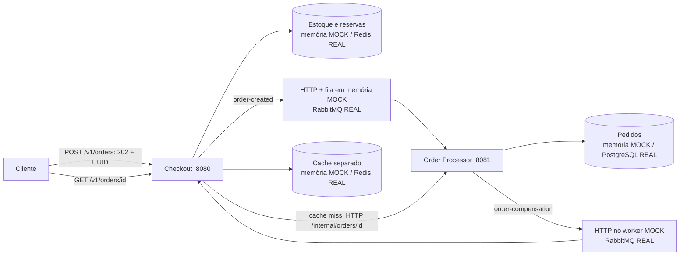

# Flash Sale: Checkout e processamento de pedidos

MVP didático em **Java 21, Quarkus 3.40.1 e Maven**, baseado na [especificação](especificacao-projeto-final.md), especialmente no roteiro da seção 9. Recebe compras sem esperar pelo processamento, impede estoque negativo e compensa reservas de pedidos cancelados.

O **Checkout** (8080) valida a compra, possui o estoque e as reservas, publica pedidos, recebe compensações e oferece consulta com Cache-Aside. O **Order Processor** (8081) consome pedidos, mantém seu repositório e publica compensações. Não há chamadas Java entre aplicações: são processos independentes.



## 1. Modos e dependências

| Componente | MOCK (`mock`) | REAL (`real`) |
|---|---|---|
| Aplicações | Duas JVMs, HTTP real | Duas JVMs ou containers |
| Estoque | `ConcurrentHashMap.compute`, reserva atômica | Lua no Redis; reserva e idempotência atômicas |
| Mensageria | HTTP + fila limitada em memória + worker | Filas duráveis RabbitMQ, confirms, ack, retry e DLQ |
| Pedidos | Repositório em memória do Processor | PostgreSQL próprio do Processor |
| Consulta | Cache de memória separado, TTL 300 s | Redis, TTL 300 s |
| Intenção de publicação | Memória | Outbox no PostgreSQL do Checkout |
| Infraestrutura externa | **Nenhuma; sem Docker** | Redis, RabbitMQ, dois PostgreSQL via Compose |

Pré-requisitos locais: **JDK 21** e **Maven** (ou o Maven Wrapper disponível no Checkout). Os scripts auxiliares usam Bash, curl e Python 3, somente biblioteca padrão. Confira `java -version` e `mvn -version`: **ambos devem indicar Java 21**. Se necessário, configure `JAVA_HOME` e acrescente `$JAVA_HOME/bin` ao `PATH`.

No Linux, se `java -version` já indica 21, faça o Maven usar o mesmo JDK:

```bash
export JAVA_HOME="$(dirname "$(dirname "$(readlink -f "$(command -v java)")")")"
export PATH="$JAVA_HOME/bin:$PATH"
mvn -version
```

Execute os comandos seguintes na raiz do projeto. Não execute dois ambientes nas mesmas portas. Dependências Maven e imagens precisam ser baixadas na primeira utilização.

## 2. MOCK sem Docker

### Inicialização rápida

```bash
bash scripts/run-mock.sh
# Outro terminal:
bash scripts/demo-mock.sh
```

O launcher compila os dois serviços com o perfil `mock`, inicia JVMs independentes, habilita explicitamente os controles de demonstração e aguarda `/health/ready`. Ctrl+C encerra essas JVMs. Os logs ficam em [.run/checkout.log](.run/checkout.log) e [.run/processor.log](.run/processor.log).

### Inicialização independente com Maven

Em cada terminal, mantenha o respectivo processo em execução:

```bash
# Terminal 1: Processor em 8081
mvn -f order-processor-service/pom.xml quarkus:dev \
  -Dquarkus.profile=mock -Dflashsale.demo.enabled=true
```

```bash
# Terminal 2: Checkout em 8080
mvn -f checkout-service/pom.xml quarkus:dev \
  -Dquarkus.profile=mock -Dflashsale.demo.enabled=true
```

Alternativamente, para executar os artefatos JVM, compile:

```bash
mvn -f checkout-service/pom.xml package -DskipTests -Dquarkus.profile=mock
mvn -f order-processor-service/pom.xml package -DskipTests -Dquarkus.profile=mock
```

Em dois terminais:

```bash
java -Dquarkus.profile=mock -Dflashsale.demo.enabled=true \
  -jar order-processor-service/target/quarkus-app/quarkus-run.jar
```

```bash
java -Dquarkus.profile=mock -Dflashsale.demo.enabled=true \
  -jar checkout-service/target/quarkus-app/quarkus-run.jar
```

O Checkout aponta para `http://localhost:8081`; o Processor para `http://localhost:8080`. Para alterar, use `quarkus.http.port`, `quarkus.rest-client.processor.url` e `quarkus.rest-client.checkout.url`. Datasource e Dev Services estão desativados no MOCK, inclusive o início automático de containers.

### Limitações do MOCK

`order-created` é aceito por HTTP com 202, enfileirado em memória e consumido em outra thread. A compensação é enviada por HTTP pelo worker, fora da requisição original de compra; o Checkout devolve 204 após aplicá-la. São abstrações de producer/consumer, **não reproduzem as garantias do RabbitMQ**. A compensação não tem uma fila durável separada no MOCK.

Reiniciar uma JVM perde seus dados locais. A fila limitada rejeita sobrecarga com 503. Falha de publicação devolve a reserva; timeout HTTP pode ser ambíguo se o destino tiver aceitado o evento. Falha na entrega da compensação mantém `PENDING`; para tentar novamente:

```bash
curl -i -X POST http://localhost:8081/internal/mock/orders/UUID/retry-compensation
```

A restauração é idempotente por UUID e valida produto/quantidade contra a reserva original. No REAL, o outbox e o broker realizam a recuperação durável. Não se deve usar o MOCK como referência de confiabilidade em produção.

## 3. REAL com Docker Compose

Pré-requisitos adicionais: Docker Engine disponível e plugin Docker Compose. Para **infraestrutura em containers e aplicações em JVMs locais**:

```bash
bash scripts/run-real-local.sh
# Outro terminal:
bash scripts/demo-real.sh
```

Para iniciar separadamente:

```bash
bash scripts/run-infrastructure.sh
# Terminal do Processor:
mvn -f order-processor-service/pom.xml quarkus:dev \
  -Dquarkus.profile=real -Dflashsale.demo.enabled=true
# Terminal do Checkout:
mvn -f checkout-service/pom.xml quarkus:dev \
  -Dquarkus.profile=real -Dflashsale.demo.enabled=true
```

Ou **tudo em containers**, sem JDK/Maven locais:

```bash
FLASHSALE_DEMO_ENABLED=true bash scripts/run-docker.sh
bash scripts/demo-real.sh
```

O [Compose](compose.yml) inicia os componentes, aguarda healthchecks e prepara `PROD-001=10` com `SET NX` (reiniciar não repõe estoque consumido). As aplicações criam suas tabelas. Verifique conectividade:

```bash
curl -f http://localhost:8080/health/ready
curl -f http://localhost:8081/health/ready
docker compose ps
docker compose exec -T redis redis-cli PING
```

Resposta de saúde: `{"status":"UP","mode":"real"}`. O MOCK responde `mode=mock`.

| Serviço | Endereço local | Endereço entre containers |
|---|---|---|
| Checkout | `localhost:8080` | `checkout-service:8080` |
| Processor | `localhost:8081` | `order-processor-service:8081` |
| Redis | `localhost:6379` | `redis:6379` |
| RabbitMQ | `localhost:5672` | `rabbitmq:5672` |
| Management RabbitMQ | `http://localhost:15672` | `rabbitmq:15672` |
| PostgreSQL Checkout | `localhost:5433/checkout` | `checkout-db:5432/checkout` |
| PostgreSQL Processor | `localhost:5434/processor` | `processor-db:5432/processor` |

Credenciais de desenvolvimento: RabbitMQ `flashsale/flashsale`, vhost `/flashsale`; bancos `checkout/checkout` e `processor/processor`. Portas Docker são publicadas apenas em `127.0.0.1`. Personalize com [.env.example](.env.example), copiando para `.env`. Scripts/Compose leem esse arquivo; Maven/IDE não o carregam automaticamente.

### Inspeção da infraestrutura real

```bash
docker compose exec -T redis redis-cli GET stock:PROD-001
docker compose exec -T rabbitmq rabbitmqctl list_queues -p /flashsale name messages messages_unacknowledged
docker compose exec -T processor-db psql -U processor -d processor \
  -c "SELECT pedido_id, payload::jsonb->>'status' AS status FROM orders;"
docker compose exec -T checkout-db psql -U checkout -d checkout \
  -c 'SELECT pedido_id,state,compensated FROM checkout_outbox;'
# Troque UUID pelo identificador retornado:
docker compose exec -T redis redis-cli GET order:UUID
docker compose exec -T redis redis-cli TTL order:UUID
docker compose exec -T redis redis-cli HGETALL reservation:UUID
```

As filas podem estar vazias porque o consumidor já confirmou as mensagens. Use os logs correlacionados, as taxas no Management e os registros de outbox para demonstrar publicação/consumo; fila vazia não implica ausência de publicação.

```bash
# Aplicações em containers:
docker compose logs -f checkout-service order-processor-service
# Aplicações locais:
tail -f .run/checkout.log .run/processor.log
```

Logs de fronteira usam campos `event=published`, `event=consumed`, `event=compensated`, `queue=...` e `pedido_id=...`. A consulta registra `event=cache_miss`/`event=cache_hit`. São logs estruturados em chave=valor, sem CPF/nome.

`bash scripts/stop-docker.sh` encerra o ambiente Compose e preserva volumes. O modo REAL persiste dados entre reinícios; não é necessário apagar volumes para repetir a demonstração.

## 4. Roteiro mínimo: os mesmos 12 passos

Execute `bash scripts/demo-mock.sh` ou `bash scripts/demo-real.sh` com ambos os serviços prontos. O [roteiro](scripts/demo-flow.py) valida saúde e modo, HTTP, UUID v4, publicação, estados, cache e estoque, com polling e timeout configurável (`DEMO_TIMEOUT=60`). Qualquer falha retorna código diferente de zero. `CHECKOUT_URL` e `PROCESSOR_URL` permitem apontar para outras portas.

| Passo | Ação e evidência automatizada |
|---|---|
| 1 | Preparar e consultar `PROD-001=10` no Checkout |
| 2 | POST válido, quantidade 2 |
| 3 | HTTP 202, UUID v4 e status PROCESSING |
| 4 | Confirmação de publicação `order-created`: memória no MOCK, outbox SENT no REAL |
| 5 | Consultar o repositório pela API HTTP do Processor até o consumo terminar |
| 6 | Histórico PROCESSING → CONFIRMED e estoque 8 |
| 7 | GET público do pedido: HTTP 200 e X-Cache MISS |
| 8 | Repetir GET: X-Cache HIT |
| 9 | Armar marcador exclusivo de falha e criar outro pedido de 2 unidades |
| 10 | Aguardar publicação/consumo de `order-compensation`, reserva COMPLETED |
| 11 | Estoque volta a 8: apenas o primeiro pedido consumiu unidades |
| 12 | GET público do segundo pedido retorna CANCELLED |

### Execução manual com curl

Os comandos abaixo funcionam nos dois modos e usam os endereços padrão. Para extrair UUIDs, também é possível copiá-los manualmente das respostas.

```bash
# 1: controles habilitados explicitamente nos dois serviços
curl -i -X POST http://localhost:8080/internal/demo/stock
curl -s http://localhost:8080/internal/demo/stock
# {"disponivel":10}

# 2–3: -i mostra o 202; guarde o pedido_id retornado
curl -i -H 'Content-Type: application/json' -d \
 '{"produto_id":"PROD-001","quantidade":2,"cliente_cpf":"50329291076","cliente_nome":"Fernando Augusto"}' \
 http://localhost:8080/v1/orders
```

Resposta esperada (UUID e horário variam):

```json
{"pedido_id":"b819cc65-f6f0-478c-8bb7-69ee1c4f6402","status":"PROCESSING","data_hora_requisicao":"2026-10-12T20:03:57"}
```

```bash
ID=b819cc65-f6f0-478c-8bb7-69ee1c4f6402 # substitua pelo UUID recebido
# 4: {"published":true}, eventualmente
curl -s "http://localhost:8080/internal/demo/publications/$ID"
# 5–6: repetir até CONFIRMED; consulta direta ao proprietário do repositório
curl -s "http://localhost:8081/internal/orders/$ID"
# 7–8: primeira consulta pública MISS; segunda HIT
curl -i "http://localhost:8080/v1/orders/$ID"
curl -i "http://localhost:8080/v1/orders/$ID"
```

A resposta de consulta contém `pedido_id`, `produto_id`, `quantidade`, `cliente_cpf`, `cliente_nome`, `status` e `data_hora_atualizacao`, além de `historico` e `compensacao` para observação didática. Apenas CONFIRMED é cacheado: PROCESSING e CANCELLED permanecem na fonte para não esconder evolução da compensação. Ausência faz três tentativas de leitura antes de 404; dependência indisponível retorna 503.

```bash
# 9: marcador exclusivo; não afeta clientes com outros nomes
MARKER="demo-failure-$(cat /proc/sys/kernel/random/uuid)"
curl -i -X POST "http://localhost:8081/internal/demo/failures/$MARKER"
curl -i -H 'Content-Type: application/json' -d \
 "{\"produto_id\":\"PROD-001\",\"quantidade\":2,\"cliente_cpf\":\"50329291076\",\"cliente_nome\":\"$MARKER\"}" \
 http://localhost:8080/v1/orders

FAILED_ID=UUID_DO_SEGUNDO_PEDIDO
# 10–12: repetir até COMPLETED, disponível=8 e CANCELLED
curl -s "http://localhost:8080/internal/demo/reservations/$FAILED_ID"
curl -s http://localhost:8080/internal/demo/stock
curl -s "http://localhost:8080/v1/orders/$FAILED_ID"
```

`CANCELLED` pode ser observado antes de o estoque voltar: o roteiro aguarda **ambas** as condições. Não é um endpoint de cancelamento manual; o cancelamento ocorre pela falha de processamento, como especificado.

### Segurança e repetição da demonstração

Os endpoints `/internal/demo/*` retornam **404 por padrão**. Habilite `flashsale.demo.enabled=true` somente em ambiente local/dedicado. Os launchers locais fazem essa ativação; Compose exige `FLASHSALE_DEMO_ENABLED=true`. Os controles não possuem autenticação: não exponha um ambiente de demonstração a usuários externos.

A preparação redefine somente o saldo de `PROD-001` para 10; preserva pedidos, reservas e idempotência. Recusa com 409 se houver reservas cujo processamento/compensação ainda não terminou. Uma trava no Checkout impede novas compras durante a preparação, mantendo compras concorrentes fora dela. Use uma instância de cada serviço e não rode demonstrações simultâneas. Não há endpoint de limpeza global: no MOCK, encerre ambas as JVMs para limpar todo o estado. No REAL, os testes usam volumes exclusivos e removem apenas esses volumes ao terminar.

Os marcadores de falha são voláteis, explícitos e exclusivos; permanecem válidos até reiniciar o Processor para que uma reentrega tenha a mesma decisão. O legado `processor.mock.failure-mode=always` continua disponível para testes de falha de todos os pedidos; mantenha `never` para o roteiro combinado.

## 5. Implementação e recuperação

- [CheckoutService](checkout-service/src/main/java/br/com/estudo/flashsale/application/CheckoutService.java) compartilha a validação usada pelo [RealCheckoutService](checkout-service/src/main/java/br/com/estudo/flashsale/application/RealCheckoutService.java). A orquestração de outbox/transações permanece específica da infraestrutura REAL.
- [ProcessingPolicy](order-processor-service/src/main/java/br/com/estudo/flashsale/application/ProcessingPolicy.java) e [Order](order-processor-service/src/main/java/br/com/estudo/flashsale/domain/Order.java) compartilham decisão de confirmação/cancelamento e transições entre memória e PostgreSQL.
- [OrderCache](checkout-service/src/main/java/br/com/estudo/flashsale/ports/OrderCache.java) tem adaptadores de memória e Redis. O algoritmo Cache-Aside é único na [consulta](checkout-service/src/main/java/br/com/estudo/flashsale/api/OrderQueryResource.java); falha de cache permite consultar a fonte por HTTP.
- No REAL, Checkout grava PREPARED, reserva com Lua e muda para READY. O worker publica com confirmação do RabbitMQ e marca SENT. Reentregas não reservam/devolvem estoque novamente.
- Processor grava resultado e intenção de compensação na mesma transação. O ack ocorre após o processamento. Falhas de infraestrutura são reenviadas pela fila `.retry`, com limite de tentativas e `.dlq` para inspeção.
- Bancos segregados: [schema Checkout](checkout-service/src/main/resources/db/schema.sql) e [schema Processor](order-processor-service/src/main/resources/db/schema.sql). A consulta nunca acessa diretamente o banco de outro microsserviço.

## 6. Testes automatizados

Execute com Java 21. Testes existentes foram preservados.

```bash
# Unitários: regras, concorrência e TTL sem dependências externas
mvn -f checkout-service/pom.xml test -Dtest=CheckoutServiceTest,ReservationServiceTest,InMemoryOrderCacheTest
mvn -f order-processor-service/pom.xml test -Dtest=OrderProcessingServiceTest,ProcessingPolicyTest

# Suítes completas: também integração HTTP Quarkus e controles desativados
mvn -f checkout-service/pom.xml test
mvn -f order-processor-service/pom.xml test

# Integração MOCK: dois processos em portas livres, nenhum Docker
mvn -f checkout-service/pom.xml package -DskipTests -Dquarkus.profile=mock
mvn -f order-processor-service/pom.xml package -DskipTests -Dquarkus.profile=mock
python3 scripts/test-local-flow.py

# Integração REAL: Docker, projeto exclusivo, portas livres e limpeza automática
python3 scripts/test-real-flow.py
```

O perfil `test` usa publisher de memória isolado no Checkout para testes unitários/Quarkus. **Não serve para demonstrar integração entre os serviços**. O perfil `mock` usa HTTP por padrão; não é necessário alterar código. Recompile ao mudar o perfil de build, pois endpoints legados de inspeção usam condições de build. Os controles novos usam configuração de runtime.

Critérios de aprovação:

| Cenário | Verificações |
|---|---|
| Contratos | 202 + UUID, dados inválidos 400, estoque insuficiente 409, pedido ausente 404 |
| Concorrência | Número de aceitações igual ao estoque; nunca negativo |
| MOCK HTTP | Duas JVMs, confirmação assíncrona, eventos duplicados, indisponibilidade do Processor, reserva devolvida |
| Cache | MISS → HIT no roteiro; TTL com relógio controlado em teste unitário; TTL real no Redis |
| SAGA | CANCELLED, estoque restaurado uma vez, compensação duplicada, falha de entrega e retry |
| Segurança de demonstração | Endpoints de preparação/falha retornam 404 sem habilitação |
| 12 passos | O mesmo roteiro executado dentro das duas suítes ponta a ponta |
| REAL | Bancos separados, persistência após reinícios, outbox recuperado após indisponibilidade de broker/Redis, concorrência, compensação após reinício e DLQ |

As suítes ponta a ponta encerram os processos/containers que criaram. Não use `python -O`, pois testes legados usam `assert`. Falha de infraestrutura ou validação produz saída não zero. Resultado de teste deve ser obtido na execução, não inferido pela documentação.

### Validação executada nesta entrega — 12/10/2026

Com Java 21: **18 testes do Checkout e 12 do Processor passaram**, sem falhas ou testes ignorados. A integração MOCK passou, incluindo duas execuções consecutivas dos 12 passos, concorrência HTTP e bloqueio de preparação com compensação pendente. O launcher e o comando de demonstração MOCK também foram exercitados. A integração REAL passou em projeto Compose isolado com Redis, RabbitMQ e PostgreSQL, incluindo os 12 passos, reinícios, recuperação de outbox, concorrência, idempotência, DLQ e logs correlacionados. O launcher `real-local` não foi executado ponta a ponta nesta validação; o modo REAL foi validado com aplicações em containers.

## 7. Solução de problemas

| Sintoma | Diagnóstico e ação |
|---|---|
| Porta ocupada | Encerre execução anterior ou ajuste `.env`; atualize URLs HTTP dos dois serviços |
| Maven usa Java diferente | Configure `JAVA_HOME` para o JDK 21 e confira `mvn -version` |
| MOCK tenta conectar em infraestrutura | Remova `QUARKUS_PROFILE=real`/`FLASHSALE_REAL=true` herdados; use perfil mock e as propriedades fornecidas |
| 503 criando pedido MOCK | Processor/HTTP indisponível ou fila cheia; veja URL e logs; reserva é devolvida |
| 503 consultando | Verifique Processor e, no REAL, seu PostgreSQL; indisponibilidade de Redis cache permite fallback |
| 404 em `/internal/demo/*` | Habilite `flashsale.demo.enabled=true` nos dois processos e reinicie; não é o mesmo que selecionar mock |
| 409 preparando estoque | Há pedidos em trânsito ou compensação pendente; termine/recupere esses pedidos antes de repetir |
| Roteiro encontra perfil incorreto | Não misture um serviço mock com outro real; `/health/ready` informa o modo |
| Roteiro sucesso cancela | Remova `PROCESSOR_MOCK_FAILURE_MODE=always`/`PROCESSOR_FAILURE_MODE=always` |
| REAL não fica pronto | `docker compose ps`, credenciais, portas dos bancos, Redis e vhost `/flashsale`; dentro de container use nomes DNS, não localhost |
| CANCELLED com saldo ainda reduzido | Aguarde polling; inspecione compensação/outbox e DLQ; no MOCK use retry manual |
| Cache sempre MISS | Consulte um pedido CONFIRMED duas vezes dentro de 300s; estados transitórios e cancelados não são cacheados |
| Falha ao baixar dependências/imagens | Verifique rede e repositórios; primeira compilação pode demorar |

## 8. Limites do MVP

Sem autenticação, pagamento real ou alta disponibilidade. O REAL depende da preservação conjunta dos volumes: Redis é autoridade do estoque/idempotência, PostgreSQL mantém intenções e pedidos. Não há transação distribuída, e perder volumes pode impedir recuperação. Outboxes, reservas, pedidos e marcadores ainda não têm política de retenção. Cache em memória limpa entradas vencidas nas leituras e novas gravações. A preparação de demonstração pressupõe uma única instância de Checkout; não é uma operação administrativa distribuída para produção.
